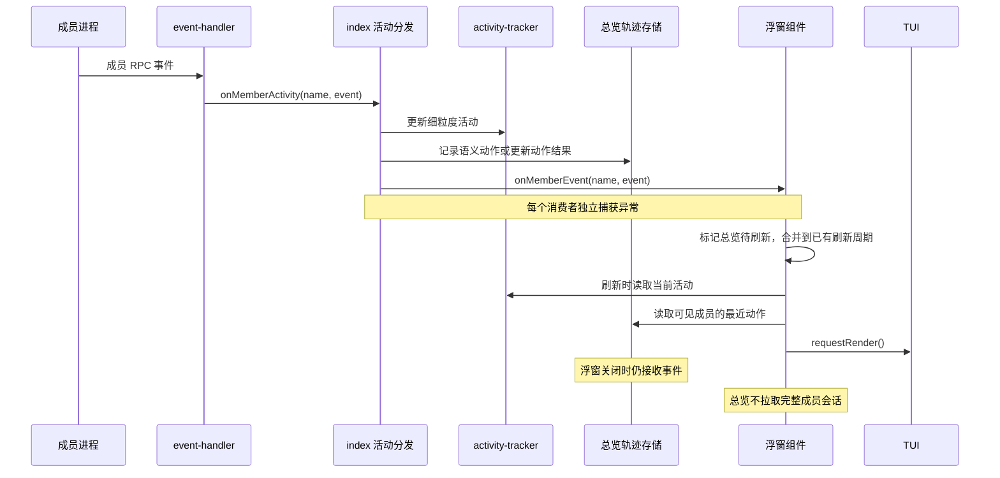

# 成员浮窗总览页设计

> 状态：已实现，自动验证记录见 §7.4；真机交互待用户验收。日期：2026-10-23。
> 用户已确认：每个成员一行图标轨迹。只移除浮窗内的状态汇总行，保留浮窗外的团队状态条。
> 第二轮显示修订：无表头、无状态文字列、无底部图例。新操作在左，最多20个图标，尾部用 `(N)` 显示隐藏记录。上下文增加水平占用条。

## 1. 项目背景与主要目的

### 1.1 现状

`alt+t` 目前直接打开第一个成员的会话。底部把所有成员的状态和上下文占用拼成一行。成员较多时，这行会截断。

成员会话支持流式更新，但没有全员操作轨迹。查看谁在工作，需要反复切换成员标签。

### 1.2 本次目标

1. 打开浮窗默认显示「总览」。每次重新打开都回到总览。
2. 每个成员占一行。该行显示当前状态、上下文占用和最近操作图标。
3. 新操作插入轨迹左侧。最多显示20个图标，窄屏继续减少，尾部用 `(N)` 表示未显示的记录数。
4. 左右键切换总览和成员会话。成员原有会话功能保留。
5. 移除浮窗底部的全员状态汇总行。保留快捷键提示和操作反馈。
6. 保留编辑器上方的团队状态条。关闭浮窗后仍能查看团队状态。

### 1.3 非目标

不修改派发、等待、压缩、路由和控制面状态机。不显示思考原文、工具参数、文件路径或工具结果。不新增持久化操作日志。不把图标轨迹当成审计日志。

本文中的布局已按用户选择确定。图标、容量和快捷键细节是建议值，实施时以本文验收项为准，若需改变则先说明。

## 2. 实现方案概述

### 2.1 推荐布局

```text
╭─ Member Inspector ───────────────────────────────────────────╮
│ ❰总览❱  开发员  审查员  测试员                               │
├──────────────────────────────────────────────────────────────┤
│ › 开发员   [████░░░░░░] 42%   📖 ✏️ 🔧 📝 📖 💭 (12)        │
│   审查员   [███░░░░░░░] 31%   💭 📖 💭 📖                   │
│   测试员   [██░░░░░░░░] 18%   ✅ ✏️ 🔧 💭                   │
│   文档员                  —   ⏹️                            │
│                                                              │
│                                                              │
├──────────────────────────────────────────────────────────────┤
│ ←→ 切页  ↑↓ 选择成员  Enter 查看会话  Esc 关闭                 │
│ ctrl+b 全部中断                                              │
╰──────────────────────────────────────────────────────────────╯
```

这是结构示意图，不作为终端列宽的金样。实现必须按可见列宽测量。

- **固定区域**：成员名、上下文水平占用条和百分比。没有表头和状态文字列。
- **弹性区域**：图标轨迹。最新在左，最左图标表示当前状态。
- **显示上限**：含当前状态位置最多20个图标。宽度不足时减少图标，并为尾部 `(N)` 留足空间。
- **隐藏计数**：只统计本次会话缓冲区中未显示的真实操作记录，不把补充的当前状态图标算成历史记录。最新记录能直接表示当前状态时复用该记录，不重复追加图标。
- **选中行**：左侧显示 `›`，成员名加粗。
- **当前工作**：轨迹最左图标通过形状、语义色和下划线表示。没有独立状态文字。
- **正在发生的操作**：对应轨迹图标高亮并加下划线。动作结束后取消强调。不做持续闪烁。
- **成员顺序**：采用团队名册顺序。不随状态变化排序，避免行位置跳动。
- **无记录**：仍显示当前状态图标，但不伪造历史记录，也不显示 `(0)`。

一个成员同时只有一行。不增加独立的全员时间列表。

### 2.2 当前状态

显示优先级：崩溃/停止、成员侧确认的压缩、细粒度活动、运行兜底、空闲。控制面的 compacting 兼作 stats 查询占位，不是压缩事实，不能据此显示或记录 🗜️。

| 当前情况 | 轨迹最左图标 | 颜色建议 |
| --- | --- | --- |
| 正在思考 | 💭 | accent |
| 正在生成工具调用 | 🔧 | warning |
| 正在执行工具 | 📖 / 📝 / 🔧，优先复用最新活动工具 | warning |
| 正在输出文字 | ✏️ | success |
| working，但无明确活动 | 💭 | 默认色 |
| 空闲 | ✅ | muted |
| 正在压缩 | 🗜️ | warning |
| 进程崩溃 | 💥 | error |
| 未启动或已停止 | ⏹️ | muted |

未启动和已停止统一显示 ⏹️，不增加文字标签。控制面状态优先于历史活动，避免崩溃后仍把工具图标放在当前状态位置。

轨迹最左图标回答“现在在做什么”。后续图标回答“最近做过什么”。后续图标中的 ✅ 不代表当前空闲。

### 2.3 操作图标

| 图标 | 含义 | 记录粒度 |
| --- | --- | --- |
| 💭 | 思考 | 每个思考内容块一条 |
| ✏️ | 输出文字 | 每个文字内容块一条 |
| 📖 | 调用 read | 每次工具调用一条 |
| 📝 | 调用 write 或 edit | 每次工具调用一条 |
| 🔧 | 其他工具，包括 bash、自定义工具 | 每次工具调用一条 |
| ✅ | 当前工作回合结束 | 每次 agent_end 一条，不断言任务成功 |
| 🗜️ | 压缩 | 每次可观察的压缩生命周期一条 |
| 💥 | 进程异常退出或进程错误 | 每次进程异常一条 |
| ⏹️ | 进程正常停止 | 每次进程正常停止一条 |

失败的工具图标使用 error 色并加下划线。它仍占一个位置，不再追加一个工具结束图标。不能靠 bash 的命令字符串猜测“读文件”或“写文件”。

**不按 token 记录。** 同一个思考块收到 500 次 delta，仍只显示一个 💭。连续两次 read 是两次操作，必须保留 `📖 📖`，不能合成一个。

工具参数生成期间可以显示临时 🔧。执行开始后，按同一个 toolCallId 原位换成 📖、📝 或 🔧。同一次调用不产生两条记录。拿不到工具 ID 时，只在执行开始记录，避免猜测合并。

### 2.4 上下文占用

- 数值正常时显示水平占用条和百分比，例如 `[████░░░░░░] 42%`。宽屏使用10格，窄屏依次缩为8/5/3/2格，极窄时仅保留百分比。
- 压缩后 percent 为 null 时显示 `[··········] ?`，不能显示空占用条加 `0%`。未知与真实0%使用不同条形。
- 首次查询未完成、响应无数据或首次查询失败时显示 `?`。
- 停止或崩溃时显示 `—`，不把旧百分比当成当前值。
- 最近一次查询失败时，旧值显示为 `~42%`。后续成功后恢复 `42%`。
- 保留五秒轮询间隔。打开浮窗时立即查询一次，不先空等五秒。

### 2.5 成员较多和窄屏

不显示表头。所有正文行均用于成员，上下滚动和 PgUp/PgDn 的容量与正文行数一致。

宽度优先级：当前状态图标、百分比和隐藏计数 → 成员名与占用条 → 更多历史图标。长名称截断为 `分析后端…`。名称相同时，优先显示成员标识。图标和括号计数必须完整，不能截断半个 emoji 或 `(N)`。

16列及以上的有效正文宽度覆盖保留状态和完整计数的测试。极窄到无法同时容纳时，优先保留选择标记、占用数值和当前状态。不能用最小20列强撑布局，导致右边框越界。

标签栏固定保留「总览」。成员标签采用水平窗口，只展示能容纳的部分。窗口跟随当前成员页面，左右两端用 `‹`、`›` 表示还有标签。切到总览时优先展示选中行附近的成员标签。不把所有标签拼完后直接截断，避免当前标签不可见。

## 3. 复杂流程说明



轨迹存储属于团队会话，不属于浮窗实例。关闭后重新打开，应显示已有轨迹，而不是从零开始。

## 4. 文件修改清单

以下模块已按分工实现。另新增 `src/index-overview.test.ts` 验证实际入口接线；并迁移既有 interaction/entries 会话测试，使其显式进入成员页后再检查旧功能。

| 文件 | 操作 | 主要内容 |
| --- | --- | --- |
| `src/ui/member-overview-store.ts` | 新增 | 有界轨迹存储、动作去重、生命周期和工具结果更新 |
| `src/ui/member-overview-state.ts` | 新增 | 总览行、列宽、可见窗口和图标布局纯函数 |
| `src/ui/member-inspector-state.ts` | 修改 | 页面联合类型、总览选中行、标签窗口。移除全员 footer 格式化函数 |
| `src/ui/member-inspector.ts` | 修改 | 默认总览、按页面分流按键/刷新/渲染、移除状态汇总行、迁移 notice 和新消息提示 |
| `index.ts` | 修改 | 会话轨迹存储、活动分发顺序、浮窗依赖注入和清理 |
| `src/ui/member-overview-store.test.ts` | 新增 | 语义事件、去重、有界内存、异常和重启测试 |
| `src/ui/member-overview-state.test.ts` | 新增 | 图标布局、排序、选择和窄屏测试 |
| `src/ui/member-inspector-state.test.ts` | 修改 | 总览与成员页导航、成员同步和底栏迁移 |
| `src/ui/member-inspector.test.ts` | 修改 | 默认页面、页面分流、行数预算、快捷键和关闭测试 |
| `src/index-overview.test.ts` | 新增 | 关闭浮窗时采集、生命周期、消费者异常隔离、重启和旧来源隔离 |
| `DESIGN.md` §17 | 修改 | 更新浮窗布局、数据流和键位 |
| `AGENTS.md` | 修改 | 登记新增模块和总览行为 |

`src/ui/team-status-widget.ts` 和 `src/channel/activity-tracker.ts` 不改变现有行为。工具和控制面接口不变。不需要新增 ADR。

## 5. 详细修改方案

### 5.1 会话开始：建立独立轨迹存储

在 `index.ts` 建立 `MemberOverviewStore`。按团队 sessionId 初始化。相同 sessionId 的重复 UI 安装不能清空轨迹。

- 每个成员保存最近 64 个动作，使用环形缓冲区。
- 只保存动作类型、短工具名、工具 ID、结果和必要的块编号。
- 不保存思考正文、参数 JSON、工具结果或完整 RPC 事件。
- 工具 ID 和短工具名限制保存长度。超过长度时，不建立可冲突的截短 ID 索引，采用不关联的执行记录。
- 动作关联索引必须随淘汰同步删除，不能单独无限增长。
- 去掉的成员清理存储。停止会话和 session_shutdown 清空全部存储。
- 同一会话内关闭浮窗不清空。成员崩溃重启保留最近轨迹，并重置当前进程的块/工具关联状态。
- `/team resume`、扩展重载和 TL 重启后从新采集。没有轨迹持久化，不伪造恢复旧记录。

错误处理：未知事件直接忽略。坏事件不能影响消息路由或状态转换。存储不创建定时器。

### 5.2 事件进入：提取语义动作

保持 `activity-tracker` 的既有纯函数与 O(1) 事件纪律。总览在独立消费者中提取动作，不能给 tracker 添加工具参数或历史文本。

调用顺序调整为：tracker 更新 → 进程死亡时清理 tracker → 总览存储 → inspector 通知 → widget 通知。每个消费者继续独立 try/catch。

思考和文字用“当前消息代际 + contentIndex + 内容类型”去重。收到对应 start 时创建记录。漏掉 start、首次收到 delta 时补建。end 只结束该记录。message_start 切换消息代际，agent_start 重置回合门，agent_end 后迟到的旧 delta 不得创建新记录。agent_start 的默认 thinking 只影响最左的当前状态位置，不向存储追加虚构的思考记录。

工具使用 toolCallId 关联。参数生成和执行尽量更新同一条记录。并行工具分别记录。工具结束时只更新结果。不把 tool_execution_update 的每个进度片段追加成新动作。message_end 中出现同一工具结果时也不能重复记录。

压缩只使用成员侧 compaction 开始事件或成功的 get_state.isCompacting=true 记录。派发层会在检查用量之前设置控制面 compacting，未达阈值也会经过该状态，因此禁止采样它来创建压缩历史。缺少开始依据时，结束事件必须带成功的 `result.summary` 才能补记一次已结束的压缩。孤立的结束通知、无结果、失败或取消通知不创建压缩历史，避免将其误记为成员的最早操作。已观察到开始的真实压缩仍记录成功/失败结果。不能将压缩过程的 agent_end 误标为普通任务完成。

下面是可独立编译的工具分类示例，不包含事件提取和存储实现：

```typescript
export type ToolActionKind = "read" | "modify" | "tool";

export function classifyToolAction(toolName: unknown): ToolActionKind {
  if (toolName === "read") return "read";
  if (toolName === "write" || toolName === "edit") return "modify";
  return "tool";
}

export function toolActionIcon(kind: ToolActionKind): string {
  switch (kind) {
    case "read": return "📖";
    case "modify": return "📝";
    case "tool": return "🔧";
  }
}
```

### 5.3 打开浮窗：初始化页面和数据依赖

不把「总览」伪装成 InspectorTab。InspectorTab 对应真实成员，会被 RPC、消息发送和压缩控制路径使用。

使用显式页面类型，以成员 name 保存页面身份。不要同时保留两个可修改的 activeIndex/view 作为权威状态。

下面是可独立编译的导航示例：

```typescript
export type InspectorView =
  | { kind: "overview" }
  | { kind: "member"; name: string };

export function nextInspectorView(
  current: InspectorView,
  names: readonly string[],
  direction: -1 | 1
): InspectorView {
  const currentMemberIndex = current.kind === "member"
    ? names.indexOf(current.name)
    : -1;
  const currentPageIndex = currentMemberIndex + 1;
  const pageCount = names.length + 1;
  const next = (currentPageIndex + direction + pageCount) % pageCount;
  return next === 0
    ? { kind: "overview" }
    : { kind: "member", name: names[next - 1] };
}
```

每次打开的初始 view 为 overview。`activeTab` 在总览页返回 undefined。所有原先依赖 activeTab 的分支都必须检查当前页面，不能把 undefined 误判为团队没有成员。

`MemberInspectorDeps` 增加 `getActivity(name)`、`getRecentActions(name)` 和 `isCompacting(name)` 只读依赖。isCompacting 来自存储的成员侧确认标志，不根据控制面占位或可见轨迹推测；即使压缩条目被环形缓冲淘汰，仍保持真实压缩状态，进程重启/退出清除。存储不向组件暴露可变数组。

总览初始渲染不加载完整会话。立即查询各个存活成员的 stats，最多四路并发，每次三秒超时。下一轮在本轮结束后五秒开始，避免轮询重叠。响应写回前检查组件是否关闭、成员是否仍存在、进程句柄是否仍为查询时的句柄。失败保留旧值并标记为旧数据，不发聊天区通知。

### 5.4 键盘交互：按页面分流

| 按键 | 总览页 | 成员会话页 |
| --- | --- | --- |
| ← / → | 在总览和成员页之间循环切换 | 同左 |
| ↑ / ↓ | 每次选择上一位/下一位成员，自动滚动窗口 | 保留原会话滚动 |
| PgUp / PgDn | 按一个可见窗口移动选择 | 保留原翻页 |
| Home / End | 选择第一个/最后一个成员 | 保留现状：Home 无绑定，End 跳会话底部 |
| Enter | 进入选中成员的会话 | 打开输入框 |
| i | 提示“进入成员会话后发送消息” | 打开输入框 |
| ctrl+a / ctrl+o | 提示“进入成员会话后操作” | 保留单成员中断/压缩 |
| ctrl+b / ctrl+shift+a | 保留全员中断 | 保留全员中断 |
| e / t | 无操作，不显示对应提示 | 保留全局显示开关 |
| Esc | 关闭浮窗 | 保留分层退出 |

总览选中行只用于浏览和 Enter 跳转，不隐式成为破坏性操作目标。输入模式分支始终优先，左右键仍移动光标。不能因为新增页面而改变 Ctrl+Enter、Alt+Enter、Home/End 或 IME 光标协议。

动态加入成员时追加新行，保留当前页面和选中成员。删除当前成员时回总览，并选中最近的有效成员。空团队仍能显示总览，显示“暂无成员”，Enter 不发 RPC。

### 5.5 刷新和渲染：只布局可见行

总览刷新复用合并调度：基准 100ms，成本较高时退避，最长一秒。只在显示签名改变时请求刷新。思考/文字的后续 delta 只更新活动存活信息，通常不改变图标轨迹。

总览页只生成可见成员的表格行。不能为刷新一个图标重建所有成员会话。切入成员页时，沿用现有增量会话拉取和流式补齐。切回总览时立即显示最新快照。

状态和百分比是采样显示，不承诺逐 token 更新。进程退出和压缩状态变化必须触发刷新，即使最近的轨迹图标恰好没有改变。活动状态读取沿用陈旧判定，五秒 stats 轮询结束也触发一次刷新，防止长时间无事件时状态冻结。

存储仍按事件到达顺序保存。渲染时反向读取，最新图标在左，不反转原数组。最多显示20个完整图标（含当前状态位置），隐藏计数同时包含数量上限和宽度不足隐藏的真实记录。开始新动作时才推动历史向右，不能通过不断追加相同图标伪造活动。

使用 pi-tui 公开导出的列宽工具。以 grapheme 为单位保留完整图标，计入 emoji 变体选择符和 ANSI 零宽序列。只缓存未着色语义数据或在 invalidate 时清除主题化缓存。

### 5.6 底栏：删除汇总行，保留反馈

现有 render 的 footer1 混合了全员状态、notice 和“↓ 有更新”。不能直接删除整段后丢掉错误和发送反馈。

- 删除全员状态汇总行及其 `buildFooterStatusLine` 调用。
- notice 临时替换第一条快捷键提示。下一次明确导航或操作可清除，不增加常驻行。
- 会话的“↓ 有更新”迁到第一条提示的末尾，并优先于低优先级快捷键保留。
- 总览保留两条提示：导航提示、全员中断快捷键。移除图标图例。
- 成员页保留两条提示或输入行，原有发送结果仍可见。
- 外部 `team-status-widget` 原样保留。

常规 CHROME_LINES 为7。无表头的成员窗口高度等于 bodyHeight。只有1行正文时也能显示成员；不足1行时采用紧凑布局，显示选中成员摘要和退出提示。极小高度不能通过强制最小 bodyHeight 把底边框挤出浮窗。

## 6. 质量保障措施

### 6.1 测试重点

1. 默认总览。左右切换包含总览且可以循环。零成员时仍可打开。
2. 总览不发送 prompt、compact 或单成员 abort。Enter 只打开选中会话。
3. 一千次同块 thinking_delta 只产生一个 💭。不同内容块分别记录。
4. 两次 read 保留两个 📖。参数生成、执行和结束不重复计数。
5. 并行工具、漏 start、缺少 ID、失败结果、迟到 delta 和进程重启均有用例。
6. 每成员最多 64 个动作，关联索引同时有界。关闭浮窗后仍采集，团队结束后无残留。
7. 当前状态按控制面覆盖活动状态。崩溃不能继续显示“执行工具”。
8. percent null 显示 `?`，stopped/crashed 显示 `—`。失败旧值带 `~`。
9. 总览不请求完整会话。切入成员页仍有增量回退和流式补齐。
10. 动态增删成员不串页、不跳选中成员。活动变化不重排行。
11. CJK、组合字符、emoji、ANSI 和多种窄宽度下，每行可见宽度不越界。
12. 标签栏总能看到总览和当前成员标签，数量过多时展示窗口提示。
13. 删除状态行后，notice、发送失败和“↓ 有更新”仍可见。底边框不被裁切。
14. 原输入键位、全局 e/t、IME 标记、Esc 分层退出和全员中断回归通过。
15. 关闭时取消刷新与 stats 定时器，在飞请求结束后不重排。异常消费者不影响其他消费者。

### 6.2 性能目标

以 24 个成员和每成员 500 个流式事件为压力场景。

- delta 不发 RPC，不生成新轨迹记录。
- 相同语义签名不反复渲染。
- 刷新请求合并到 100ms–1s 窗口内。
- 渲染只处理可见行，不按历史正文长度增长。
- 记录存储为 O(成员数 × 64)，不持有原始大事件。
- 实测记录键盘响应和单帧耗时，不预先宣称已有性能结果。

## 7. 部署与验证指南

### 7.1 实施顺序

1. 先写轨迹存储和布局测试，确认测试为红。
2. 实现独立存储和布局纯函数。
3. 接入页面状态、活动依赖和按键分流。
4. 删除汇总行，迁移反馈并修正高度预算。
5. 完成集成测试，更新 AGENTS.md 和 DESIGN.md。

### 7.2 自动验证

已执行定向验证和全量验证，最终结果见 §7.4。复验命令：

```bash
npx vitest run src/ui/member-overview-store.test.ts src/ui/member-overview-state.test.ts
npx vitest run src/ui/member-inspector*.test.ts src/index-overview.test.ts src/index.test.ts
npm test
npm run check:goal-reminder
```

### 7.3 人工验收

| 场景 | 操作 | 预期 |
| --- | --- | --- |
| 首次打开 | 启动团队，按 alt+t | 默认总览，每成员一行 |
| 并发工作 | 两个成员交替读取、思考和输出 | 新操作插入左侧，最左图标反映当前状态；超过20个或宽度不足时尾部显示 `(N)` |
| 长时间思考 | 让一个成员持续思考 | 当前思考图标持续强调，不出现满屏重复 💭 |
| 成员较多 | 加入24位成员，上下选择 | 无表头，所有正文行均显示成员，窗口滚动且顺序稳定 |
| 切页 | 左右切换，或总览中 Enter | 正确进入成员会话，再切回时轨迹继续更新 |
| 关闭重开 | 关闭浮窗，成员继续工作，再打开 | 默认总览，能看到关闭期间采集的最近操作 |
| 压缩和失败 | 手动压缩、制造一次工具失败和进程退出 | 状态及时变化，未知占用不显示 0%，工具失败可辨认 |
| 窄屏 | 缩小终端，再恢复 | 轨迹减少或隐藏，百分比优先保留，无半个 emoji、无越界 |
| 底栏 | 发送消息、触发失败、向上翻会话 | 无全员状态汇总行，仍有反馈和新消息提示 |
| 外部状态条 | 关闭浮窗 | 编辑器上方团队状态条仍在 |

### 7.4 实施补充与验证记录

- 实现保持本方案的页面、图标和状态条移除范围。新增独立入口测试文件 `src/index-overview.test.ts`，不把接线用例继续堆进原有大型入口测试文件。
- 独立审查发现两项小屏缺口，均先补红测试后修复：16/17列下选择行缺少可见反馈；终端9/10行时常规布局只剩表头，无法看到成员。
- 另补两项启动/隔离回归：成员重启但未进入首个 agent_start 时也要恢复轨迹采集；旧会话/旧句柄的显示事件不能污染新总览。index 包装成功的 start 注入显示专用 process_started，并按来源 sessionId 和 handle 身份过滤显示观察者。消息路由和控制面逻辑未改。
- 最终全量验证：`npm test` 为92个文件通过、2个文件跳过，2144个测试通过、3个测试跳过。`npm run check:goal-reminder`、`npx tsc --noEmit --pretty false` 和 `git diff --check` 均通过。
- 独立复审确认四项已发现问题均修复。入口接线7例与原入口79例合计86例通过，覆盖新句柄重启、同句柄自动重启及跨会话旧事件。
- CLI 加载冒烟通过：`printf '' | timeout 10 ./node_modules/.bin/pi --mode json --no-tools --no-extensions -e ./index.ts`。本机全局配置还加载另一份同名扩展，直接执行原冒烟命令会工具重名；`--no-extensions` 仅禁自动发现，保留显式 `-e`，隔离后退出码为0，无加载错误。
- 第二轮显示修订已按六项反馈实现：移除表头、图例和状态文字列，操作最新在左、最多20图标且有隐藏计数，上下文增加水平占用条。定向布局/集成测试68项通过。全量 `npm test` 为2162项通过、3项跳过，TypeScript检查和Goal扫描通过。
- 压缩历史误记回归：孤立 compaction_end 无开始依据且无成功结果时不创建记录；带成功结果仍能修复漏开始，真实已开始的取消/失败仍保留。新增与调整用例先9红后绿，最终全量2171项通过、3项跳过，TypeScript检查、Goal扫描和空白检查通过。该回归复现的是可导致误记的代码路径，未读取用户实际运行会话日志来确认其具体触发事件。
- 后续真实路径排查确认：自动压缩开启时，单任务派发在查询 stats 前就设置控制面 compacting。该状态只是防重入占位，未达到阈值时不会发送 compact RPC；原先 index 对控制面边沿的采样才是首条 🗜️ 的误记来源，上一项孤立结束修复未覆盖此路径。已抽查实际成员会话无压缩条目，并用真实 team_send_and_wait→通道→stats 回复的集成路径复现：100 tokens、阈值524288、不发送 compact，旧实现仍生成首条压缩历史。
- 修复移除控制面采样，以成员侧开始/结束/get_state证据维护独立压缩标志，同时修正总览当前状态，保留原派发锁和控制面机制。600000 tokens 超阈值对照组仍执行一次 compact 并记录一次真实压缩。定向113项通过，最终全量2176项通过、3项跳过，TypeScript检查、Goal扫描、空白检查及隔离CLI加载冒烟均通过。控制面/派发源文件没有修改。修复合并后需重载扩展或重启pi，单纯关闭重开浮窗不会更新已加载代码；旧内存中的历史不自动改写。
- 尚未声称本轮真机显示或 IME 验收完成。请按 §7.3 在实际终端检查图标宽度、窄屏和原输入法交互。
